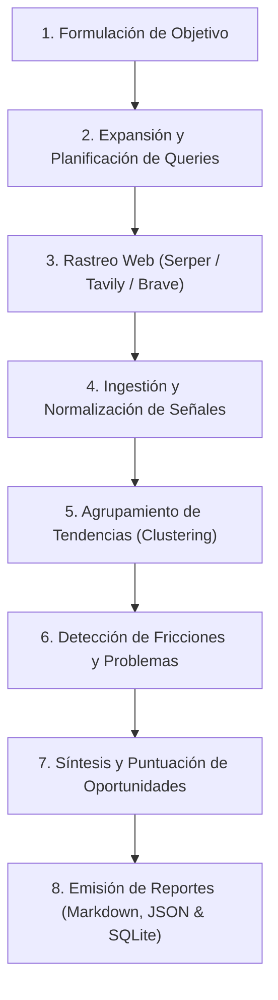

# 02_PROCESSES: Pipeline de Investigación y Análisis (INVESTIGATION_PIPELINE)

Este documento describe el flujo secuencial y concurrente que sigue el motor de CHISMOSO desde que se recibe un objetivo de mercado hasta la emisión de oportunidades validadas.

---

## Fases del Pipeline

---

### Fase 1: Formulación de Objetivo
El usuario ingresa un tema de investigación en lenguaje natural (ej. *"Startups de inteligencia artificial emergentes en Colombia"*), junto con un ámbito geográfico y límites de tiempo/queries.

### Fase 2: Planificación de Queries
El planificador ReAct descompone el objetivo en múltiples consultas estratégicas (tendencias, noticias recientes, dolor de clientes, competidores, estadísticas).

### Fase 3: Rastreo Web en Vivo
- Se realizan peticiones a la API de Serper (`google.serper.dev/search`).
- Se obtienen títulos, snippets, URLs orgánicas y posiciones de ranking.
- Si Serper falla o excede cuota, se activa el fallback a Tavily o Brave.

### Fase 4: Normalización de Señales
Cada resultado web se convierte en una **Señal (RawItem / Signal)**:
- Atribución de fuente (`sourceType: SEARCH_WEB`).
- Extracción de entidad, métrica, dirección y velocidad.
- Asignación de confianza base según la autoridad del dominio y frescura temporal.

### Fase 5: Detección de Tendencias (Trend Detection)
Las señales que comparten términos clave y semántica se consolidan en **Tendencias**. Se calcula:
- Frecuencia de mención.
- Estado de la tendencia (`EMERGING`, `WEAK_SIGNAL`, `SURGING`, `STABLE`).
- Score compuesto sobre 100.

### Fase 6: Análisis de Problemas (Problem Mining)
El analizador busca patrones lingüísticos de queja, barreras de entrada, costes elevados o ineficiencias descritas en los snippets.

### Fase 7: Síntesis de Oportunidades
Se cruzan las tendencias emergentes con los problemas detectados para generar una **Oportunidad de Negocio**:
- Hipótesis de solución.
- Score de oportunidad.
- Nivel de confianza cuantitativo.

### Fase 8: Persistencia y Generación de Entregables
- Se guardan los archivos finales en `download/chismoso/`:
  - `report-<id>.md`: Informe legible para humanos.
  - `report-<id>.json`: Informe estructurado para consumo por software / otros agentes.
- Se insertan las filas correspondientes en la base de datos `chismoso/data/chismoso.db`.
